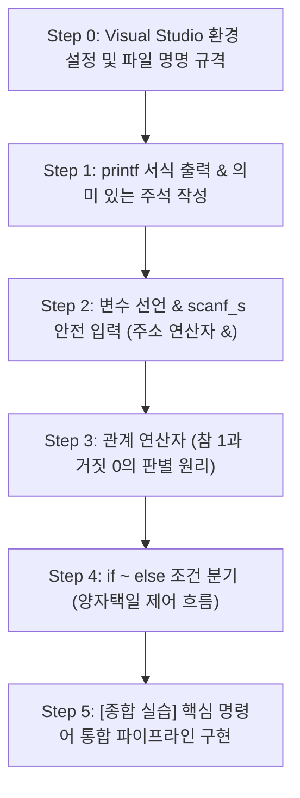

# 📋 동아마이스터고 C언어 프로그래밍 3회차 수행평가 핵심 명령어 및 학습 설계안

> **작성일자**: 2026년 11월 16일 (개정)  
> **대상 과목**: 2026학년도 C언어 프로그래밍 (동아마이스터고등학교 1학년)  
> **문서 목적**: C언어 표준 입출력 및 조건문 단원의 핵심 이론과 명령어를 체계적으로 정립하고, 단순 코드 암기를 탈피하여 명령어별 원리 이해를 통해 학생 스스로 프로그램을 설계·구현할 수 있도록 돕는 교육 설계서

---

## 1. 3회차 수행평가 핵심 명령어 체계 분석

3회차 수행평가에서 평가하는 C언어 프로그래밍의 핵심 요소는 **표준 입출력 함수, 메모리 주소 매핑, 관계 연산자, 조건 분기 제어**로 구성됩니다.

### 1) 핵심 명령어 및 문법 매트릭스

| 명령어 / 문법 | 표준 라이브러리 / 키워드 | 핵심 기능 및 이론적 원리 | 평가 요소 |
| :--- | :--- | :--- | :--- |
| **전처리기 지시자** | `#include <stdio.h>` | 표준 입출력 라이브러리 헤더 참조 | 소스 파일 상단 선언 여부 |
| **진입점 함수** | `int main(void)` | 운영체제로부터 호출되는 프로그램의 시작점 | 반환값 `return 0;` 명시 |
| **주석 (Comment)** | `//`, `/* */` | 컴파일러가 무시하는 설명글 (가독성 향상) | 학번, 이름, 코드 의도 기술 (4점) |
| **변수 선언 및 초기화** | `int score = 0;` | 4바이트(32비트) 메모리 공간 할당 및 쓰레기값 방지 | 정수형 데이터 보관 |
| **표준 출력 함수** | `printf("성적 입력 하세요:");` | 콘솔 화면에 프롬프트 출력 (줄바꿈 없음) | 출력 서식 및 디자인 일치 (4점) |
| **보안 표준 입력 함수** | `scanf_s("%d", &score);` | 서식 문자 `%d`와 주소 연산자 `&`로 메모리에 값 저장 | 주소 연산자 `&` 누락 방지 |
| **관계 연산자** | `>=` | 두 값의 대소 비교 후 참(`1`) 또는 거짓(`0`) 산출 | 이상(`>=`) 연산자 정확성 (4점) |
| **조건 분기문** | `if (...) { } else { }` | 조건식 결과에 따른 양자택일 제어 흐름 분기 | 분기 구조 및 세미콜론 주의 (4점) |

### 2) 6대 핵심 평가 기준 (24점 만점)
1. **조건 1 (프로젝트명)**: `동마고10101○○○` (학번 + 성명 형식)
2. **조건 2 (저장 위치)**: 바탕화면(Desktop)에 프로젝트 생성
3. **조건 3 (소스 파일명)**: `수행평가3.c`로 작성 (C언어 전용 `.c` 확장자 필수)
4. **조건 4 (코드 주석)**: 상단 작성자 정보 및 코드 설명 주석 필수 입력
5. **조건 5 (조건 분기)**: 관계 연산자(`>=`)와 `if ~ else`로 합격/불합격 판정
6. **조건 6 (출력 양식)**: 결과 화면의 띄어쓰기, 줄바꿈, 디자인 일치
   - 입출력 예시:
     ```text
     성적 입력 하세요:80
     합격을 축하합니다!
     ```
     ```text
     성적 입력 하세요:30
     불합격입니다 화이팅!!
     ```

---

## 2. 학생들의 주요 빈출 오류 및 감점 방지 전략

학생들이 실습 시 자주 범하는 문법적·논리적 오류를 분석하고 이를 사전에 예방합니다.

1. **`scanf_s` 주소 연산자(`&`) 누락**:
   - `scanf_s("%d", score);` 로 작성 시 변수 값(0)을 메모리 주소(NULL)로 오인하여 프로그램이 즉시 강제 종료(Access Violation)됩니다.
   - **지도 방안**: "변수 방 안에 든 값을 전달하는 것이 아니라, 방의 주소를 알려주어야 `scanf_s`가 찾아가서 값을 채워 넣는다"는 메모리 주소 개념을 강조합니다.
2. **관계 연산자 기호 혼동**:
   - 이상(`>=`) 대신 초과(`>`)를 사용하여 기준 점수 입력 시 불합격 처리되는 논리 오류.
   - 부등호 순서를 반대로 적은 `=>` 컴파일 오류.
3. **조건문 뒤 세미콜론(`;`) 실수**:
   - `if (score >= 80);` 처럼 소괄호 뒤에 세미콜론을 찍으면 조건문이 빈 문장으로 종료되어, 그 아래 중괄호가 조건과 무관하게 무조건 실행되는 치명적 버그 발생.
4. **출력 양식(띄어쓰기/콜론) 오차**:
   - `성적 입력 하세요:` 뒤에 불필요한 줄바꿈(`\n`)을 넣어 커서가 다음 줄로 이동하는 문제.
   - 문구 끝의 느낌표 개수 오차(`!` vs `!!`).
5. **환경 설정 미준수**:
   - C++ 확장자(`.cpp`)로 저장하거나 주석을 작성하지 않아 기본 감점(-2점) 발생.

---

## 3. 원리 중심 단계별 빌드업 교육 설계 (Scaffolding Design)

C언어의 **입력-연산-판단-출력** 파이프라인을 각 요소별로 분해(Deconstruction)하여 실습한 뒤, 최종 종합 프로젝트로 수렴시키는 6단계 빌드업 구조를 채택합니다.



### 단계별 학습 목표

| 단계 | 학습 주제 | 핵심 명령어 / 개념 | 학습 목표 |
| :--- | :--- | :--- | :--- |
| **Step 0** | 개발 환경 구축 | VS C 프로젝트 생성, 바탕화면, `.c` 파일 | 프로젝트명 및 소스 파일명 규격 완벽 준수 |
| **Step 1** | 출력과 주석 | `printf()`, `\n`, `//`, `/* */` | 줄바꿈 없는 프롬프트 출력 및 설명 주석 작성 |
| **Step 2** | 안전한 정수 입력 | `int`, `scanf_s()`, `%d`, `&` | 변수 메모리 할당 및 주소 연산자 `&` 원리 이해 |
| **Step 3** | 논리 비교 연산 | `>=`, `<=`, `>`, `<`, `==`, `!=` | 조건식의 참(1)과 거짓(0) 계산 메커니즘 체득 |
| **Step 4** | 조건 분기문 | `if (조건) { } else { }` | 양자택일 제어 흐름 및 세미콜론 오류 방지 |
| **Step 5** | **종합 실전 프로젝트** | **입력 + 연산 + 분기 + 주석 통합** | **빈칸 채우기 및 종합 프로그램 완성** |

---

## 4. 웹 학습 사이트 구축 및 활용 전략

학생들이 학교 실습실(PC) 또는 모바일 기기로 즉시 접속하여 학습할 수 있도록 순수 자립형(Standalone Web)으로 구축되었습니다.

### 주요 기능
1. **Interactive Navigation**: Step 0부터 Step 5까지 단계별 카드 뷰 및 학습 진행률 실시간 반영.
2. **가상 C언어 콘솔 시뮬레이터**: Visual Studio 없이도 브라우저에서 기준 점수와 성적을 입력하여 C 프로그램 실행 결과를 실시간 테스트.
3. **One-Click Code Copy**: 단계별 예제 코드 및 템플릿을 한 번의 클릭으로 클립보드에 복사.
4. **자가 진단 체크리스트**: 6대 감점 요소를 스스로 점검하고 예상 점수(24점 만점)를 확인.
5. **Modern Tech UI**: 다크/라이트 모드를 지원하는 클린 엔지니어링 인터페이스.