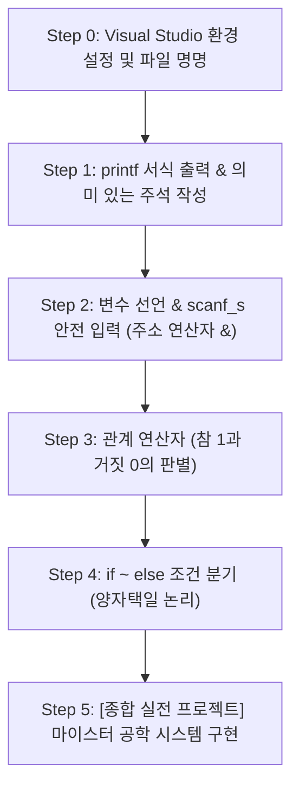

# 📋 동아마이스터고 C언어 프로그래밍 3회차 수행평가 분석 및 학습 설계안

> **작성일자**: 2026년 11월 15일  
> **대상 과목**: 2026학년도 C언어 프로그래밍 (동아마이스터고등학교 1학년)  
> **문서 목적**: 타 반 기출문제의 평가 요소를 정밀 분석하고, 단순 코드 암기를 지양하며 문법별 개념 이해와 점진적 빌드업을 통해 스스로 해결할 수 있도록 돕는 실습 웹사이트 교육 설계서

---

## 1. 타 반 기출문제 심층 분석 (Comparative Analysis)

3-5반, 3-7반, 3-8반, 3-9반 총 4개 반의 기출문제를 분석한 결과, **본질적인 코드 구조와 평가 기준은 100% 동일**하며 판정 기준 점수(임계값, Threshold)만 반별로 상이합니다.

### 1) 반별 기출문제 비교표

| 학급 | 평가 과제명 | 합격 기준 점수 | 불합격 기준 | 배점 및 감점 규칙 |
| :--- | :--- | :--- | :--- | :--- |
| **3-5반** | C언어 입력 함수를 활용한 연산자 프로그램 작성 | **60점 이상** | 60점 미만 | 24점 만점 (조건 1개당 -2점) |
| **3-7반** | C언어 입력 함수를 활용한 연산자 프로그램 작성 | **80점 이상** | 80점 미만 | 24점 만점 (조건 1개당 -2점) |
| **3-8반** | C언어 입력 함수를 활용한 연산자 프로그램 작성 | **75점 이상** | 75점 미만 | 24점 만점 (조건 1개당 -2점) |
| **3-9반** | C언어 입력 함수를 활용한 연산자 프로그램 작성 | **85점 이상** | 85점 미만 | 24점 만점 (조건 1개당 -2점) |

### 2) 공통 필수 조건 (6대 감점 항목)
1. **조건 1 (프로젝트명)**: `동마고10101○○○` (학번 + 성명)
2. **조건 2 (저장 위치)**: 바탕화면(Desktop)에 프로젝트 생성
3. **조건 3 (소스 파일명)**: `수행평가3.c`로 작성
4. **조건 4 (코드 주석)**: 코딩 시 주석(`//` 또는 `/* */`) 반드시 입력
5. **조건 5 (조건 분기)**: 기준 점수 이상이면 합격문구, 미만이면 불합격문구 출력
6. **조건 6 (출력 양식)**: 결과 화면의 띄어쓰기, 줄바꿈, 디자인 일치
   - 입출력 예시:
     ```text
     성적 입력 하세요:80
     합격을 축하합니다!
     ```
     ```text
     성적 입력 하세요:30
     불합격입니다 화이팅!!
     ```

---

## 2. 학생들의 주요 빈출 실수 및 감점 요인 (Common Pitfalls)

마이스터고 1학년 학생들이 실습 시 가장 자주 범하는 실수는 다음과 같습니다.

1. **`scanf_s` 주소 연산자(`&`) 누락**:
   - `scanf_s("%d", score);` 로 작성하여 프로그램 비정상 종료(런타임 에러).
2. **관계 연산자 기호 혼동**:
   - 이상(`>=`)을 초과(`>`)로 쓰거나, 대입 연산자(`=`)의 위치를 잘못 쓰는 경우(`=>`는 컴파일 에러).
3. **조건문 세미콜론(`;`) 실수**:
   - `if (score >= 80);` 처럼 소괄호 뒤에 세미콜론을 찍어 무조건 다음 블록이 실행되는 논리 에러.
4. **출력 양식(띄어쓰기/콜론) 오차**:
   - `성적 입력 하세요:` 뒤의 띄어쓰기 유무, 느낌표 개수(`!`, `!!`), 줄바꿈(`\n`) 오차.
5. **환경 설정 미준수**:
   - 프로젝트명을 임의로 지정하거나, C++ 확장자(`.cpp`)로 저장하여 C언어 표준 검증에서 감점.
   - 주석을 한 줄도 작성하지 않아 감점.

---

## 3. 단순 암기 방지를 위한 단계별 빌드업 교육 설계 (Pedagogical Design)

기출문제의 숫자만 바꿔서 그대로 주면 학생들은 `if (score >= 80)` 한 줄만 외우고 넘어가게 됩니다.  
따라서 C언어의 **입력-연산-판단-출력** 파이프라인을 각 요소별로 분해(Deconstruction)하여 실습한 뒤, 최종 종합 프로젝트로 수렴시키는 구조를 채택합니다.



### 단계별 학습 목표 및 실습 예제

| 단계 | 학습 주제 | 핵심 명령어 / 개념 | 연습 과제 (변형 문제) |
| :--- | :--- | :--- | :--- |
| **Step 0** | 개발 환경 구축 | VS 프로젝트 생성, 바탕화면, `.c` 파일 | 프로젝트명 `동마고10101홍길동`, 파일명 `수행평가3.c` 생성 실습 |
| **Step 1** | 출력과 주석 | `printf()`, `\n`, `//`, `/* */` | 학교명/학과/학번 출력 및 코드 설명 주석 달기 |
| **Step 2** | 안전한 정수 입력 | `int`, `scanf_s()`, `%d`, `&` | 센서 측정값 1개를 입력받아 그대로 재출력해보기 (`&` 강조) |
| **Step 3** | 논리 비교 연산 | `>=`, `<=`, `>`, `<`, `==`, `!=` | 입력값과 기준값의 비교 결과(`1` 또는 `0`)를 직접 화면에 출력하여 확인 |
| **Step 4** | 조건 분기문 | `if (조건) { } else { }` | 가열로 온도(기준 100도) 이상/미만에 따른 '정상/주의' 메시지 출력 |
| **Step 5** | **종합 실전 프로젝트** | **입력 + 연산 + 분기 + 주석 종합** | **마이스터고 스마트 팩토리 품질 검사기 / 기능사 실기 합격 판정기** |

---

## 4. 웹 학습 사이트 구축 전략 (Web Platform Architecture)

학생들이 학교 실습실(PC) 또는 모바일로 바로 접속하여 학습할 수 있도록, 별도의 복잡한 설치 없이 브라우저에서 실행 가능한 반응형 웹 애플리케이션으로 제작합니다.

### 주요 기능 사양
1. **Interactive Navigation**: Step 0부터 Step 5까지 단계별 카드 뷰 및 진행률 표시.
2. **C언어 가상 콘솔 시뮬레이터 (Interactive Web Runner)**:
   - 웹 브라우저 상에서 점수를 입력하고 [실행] 버튼을 누르면, 실제 C 프로그램처럼 출력 결과를 시뮬레이션하여 보여주는 기능.
3. **Copy to Clipboard (원클릭 복사)**:
   - 단계별 예제 코드 및 템플릿을 한 번의 클릭으로 클립보드에 복사.
4. **Self-Checklist (감점 방지 검사기)**:
   - 제출 전 학생들이 스스로 6대 감점 항목을 체크할 수 있는 인터랙티브 체크리스트.
5. **Modern Engineering Theme**:
   - 동아마이스터고의 기술 교육에 부합하는 클린 테크 다크/라이트 모드 지원 UI.
